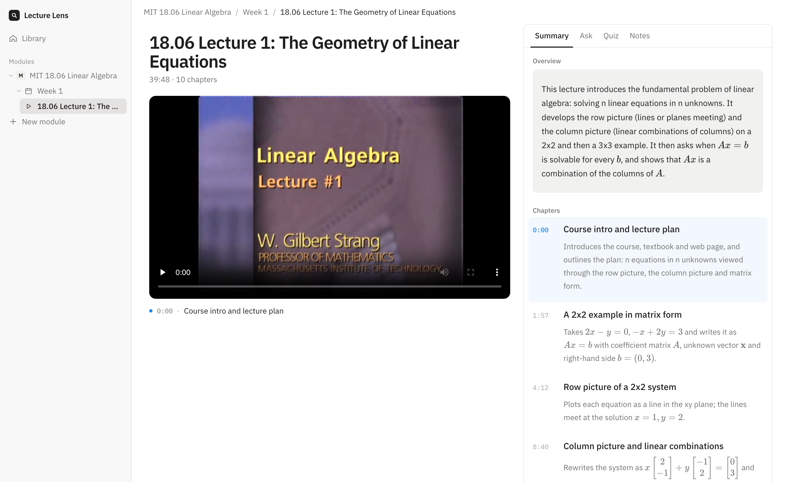

# Lecture Lens

Lecture Lens reads the board, not just the transcript.

You upload a lecture recording and it transcribes it, reads what is written on the slides and whiteboard, splits it into chapters, and lets you ask questions about it. Every answer cites the exact moment in the video, and clicking the citation jumps the player there. Hopefully, this will help your learning when rewatching lectures, or cramming a few days before the final examination

Live demo: https://lecture-lens-production.up.railway.app



## Why I made this

Most of my STEM lectures happen on the board (equations, graphs, code). Tools like NotebookLM or Panopto's AI summaries only use the transcript, so when the lecturer says "and this term goes to zero" you have no idea which term he is referring to. They also just hand you the answer, which doesn't help much when you're revising.

I wanted something that actually looks at the board, shows you where in the lecture the answer came from, and can teach you instead of just telling you.

## What it does

- **Upload a recording** (MP4, up to about 90 min). It gets processed in the background and you can watch the progress.
- **Reads the board.** It picks out the frames where the board or slide changes and reads them (equations come out as LaTeX).
- **Summary.** An overview plus chapters with timestamps, so you can see what a lecture covered in two minutes.
- **Ask.** Ask anything about the lecture. Answers cite the frame and timestamp. There are two modes:
  - *Just tell me* gives you the answer straight away
  - *Guide me* gives you a hint and points you at the board so you work it out yourself
- **Quiz.** Pick any topic and get questions one at a time. If you get one wrong it tells you the likely mix-up and the moment in the lecture that explains it.
- **Transcript and captions** under the video, synced as it plays and searchable.
- **Notes** per lecture and per module, with Markdown, math and timestamps you can click to jump the video.
- Modules and weeks to keep everything organised, plus light and dark mode.

## How it works

Each lecture goes through a pipeline, one stage at a time:

1. **ingest**: ffmpeg checks the video, converts it so any browser can play it, and pulls out the audio
2. **transcribe**: Whisper (whisper.cpp locally, or Groq's hosted Whisper on the server)
3. **frames**: samples the video and keeps a frame whenever the board or slide changes
4. **describe**: Claude reads each kept frame and writes down what's on it
5. **chapter**: Claude splits the lecture into chapters and writes the summaries

The transcript and the frame descriptions get merged into one timeline, which is what Ask and Quiz work from. Every stage saves its output, so if the server restarts mid-lecture it just carries on from the stage it was in.

**Stack:** React 19, Vite, Tailwind, TanStack Query on the front end. Hono on Node 24 with SQLite on the back end. Claude Sonnet 5.5 and Haiku 5.5 for the AI parts. Deployed on Railway with Docker.

## Running it locally

You will need Node 24, ffmpeg and an Anthropic API key. For transcription either get a free Groq API key (easiest) or install whisper.cpp.

```bash
npm install
cp .env.example .env
```

Then fill in `.env`:

- `ANTHROPIC_API_KEY`
- either `TRANSCRIBER=groq` with a `GROQ_API_KEY`, or `TRANSCRIBER=local` with whisper.cpp and the model paths
- `UPLOAD_PASSCODE`: anything you like, the app asks for it before you can upload

Start the server and the web app in two terminals:

```bash
npm run dev:server   # API on http://localhost:8787
npm run dev:web      # app on http://localhost:5173
```

Or build it and run the whole thing from one server like production does:

```bash
npm run build
npm start
```

### Other scripts

```bash
npm test                                   # tests
npm run pipeline -- run <video.mp4>        # process a lecture from the terminal
npm run pipeline -- run <YouTube link>     # same, from a YouTube link (needs yt-dlp)
npm run ask -- <lectureId> "question"      # ask a question from the terminal
npm run seed -- export <lectureId>         # pack a processed lecture into a .tar
npm run seed -- push <seed.tar> <url>      # upload it to a deployed server
```

## Deploying

There is a Dockerfile and a `railway.json`. On Railway, add a volume mounted at `/data`, set `DATA_DIR=/data`, `TRANSCRIBER=groq`, your API keys and an `UPLOAD_PASSCODE`. `DAILY_SPEND_CAP_USD` stops Ask and Quiz once the day's API spend reaches the cap.

YouTube links are turned off on the deployed server (`LINK_IMPORT=false`) because YouTube blocks downloads from cloud servers. Use the `pipeline` script locally for those, then `seed push` them up.

## Project layout

```
server/   API, processing pipeline, job runner, SQLite
web/      React app
shared/   types used by both
docs/     the original product doc
```

## Credits

The demo lectures are from MIT OpenCourseWare and Harvard CS50, used under CC BY-NC-SA. The favicon is from Flaticon. Full details in [ATTRIBUTIONS.md](ATTRIBUTIONS.md).

## License

MIT
